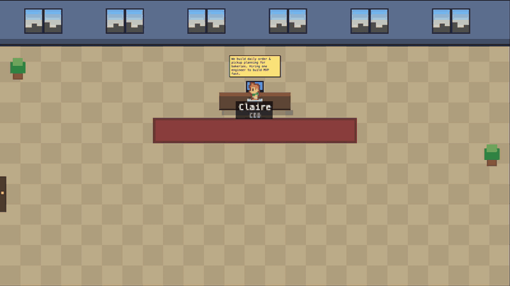

# ai-company-sim

An AI company simulation. A **CEO agent** decides what product to build, hires and fires a team with a game budget, and five **customer agents** (small businesses) review the product and pay a **daily subscription** based on how much value it gives them. You watch it all happen in a pixel-art office in your browser.



## What happens

- **Day 1:** the company starts with no employees. The CEO picks a product idea (random per world), sets a price, and proposes hires. The engine judges every hire against the budget.
- **Every day:** employees arrive at the office, the CEO plans and replies, workers build features and message each other (or the customer), salaries and rent are paid, and customers review the product.
- **Customers** (cafe, bakery, gym, clinic, freelancer) visit on their own schedule, only while the office is open. Each one subscribes or cancels depending on its scores and the daily price. Hidden needs are revealed only if the team asks.
- **Night:** everybody walks out through the door at closing time and returns the next morning.
- **Money** is decided by the engine only: cash, salaries, rent, hire fees, severance and subscription payments. The CEO can fire people to save cash. If cash runs out the company goes **BANKRUPT**.
- The right-hand **Product notebook** shows the product description and one card per day with a finance report and customer feedback.

## Quick start

```bash
git clone git@github.com:kaanersoy/ai-company-sim.git
cd ai-company-sim
npm install
npm run ui:mock      # UI in mock mode: $0, deterministic (use this for development)
```

Open http://localhost:3000 and press **Start**.

For real Claude runs, copy `.env.example` to `.env` and set `ANTHROPIC_API_KEY`, then:

```bash
npm run ui                          # UI; Start uses real Claude (Haiku) when a key exists
npm run sim -- --days 30            # CLI run, spends real money up to maxSpendUsd
npm run sim -- --mock --days 5      # CLI mock run ($0); add --fresh to reset the DB
npm test                            # unit tests
npm run typecheck
```

Real spend is capped by `maxSpendUsd` in `config.json` (default $0.20). The UI has a "+ $0.20 limit" button that raises the cap for the current server session only.

## How it works

- **Engine** (`src/engine/`): a day loop that writes everything as events into a SQLite `events` table. It knows nothing about visuals.
- **Rules** (`src/engine/rules.ts`): agents only *propose* actions (hire, fire, spend, set price); the engine judges and applies them. Agent output never changes money directly.
- **Cost guard**: every LLM call goes through `CostGuard`, which checks the worst-case cost *before* the call.
- **LLM clients** (`src/llm/`): a deterministic mock and a real Claude client using forced tool use.
- **UI** (`src/server.ts`, `web/`): a WebSocket server streams events to a pixel-canvas office (Kenney RPG Urban Pack sprites, CC0). The UI only reads and replays events.

## Configuration

Everything tunable lives in `config.json`: prices, starting budget, office rent, subscription thresholds (`subscribeAvg`, `cancelAvg`), price range, the customer list, and `maxSpendUsd`.

A customer's daily value is `payCap * (avg / 10)^1.5`. A customer subscribes when its average score is high enough and the price is at most that value, and cancels when the score drops or the price exceeds the value.

## License

Character art: Kenney RPG Urban Pack (CC0).
